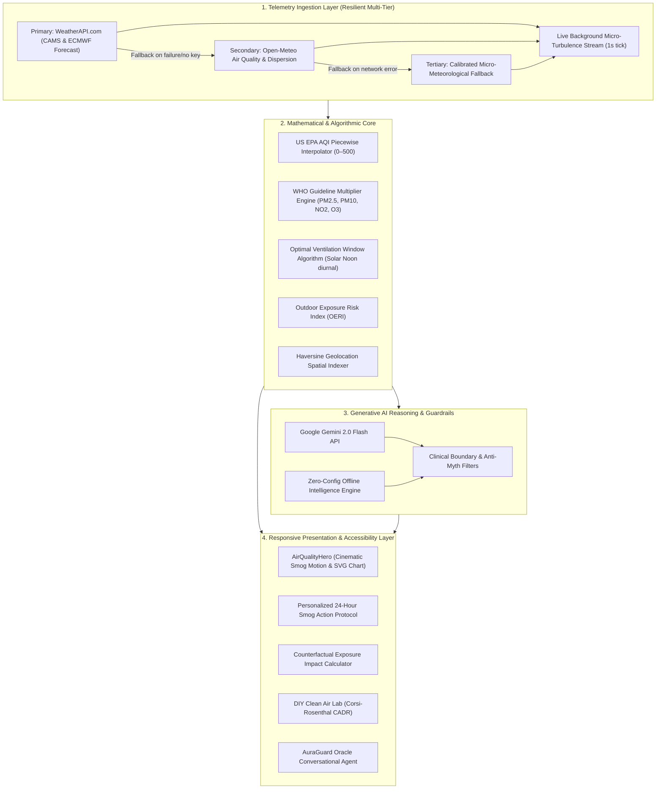

# 🏛️ AuraGuard AI — System Architecture & Design Specification

> **Architectural Overview of AuraGuard AI: Urban Air Quality & Winter Smog Assistant**  
> *Submitted for PromptWars Virtual 2026 — Challenge 6*

---

## 📐 1. System Architecture Diagram



---

## 🧩 2. Core Design Patterns

### 1. Strategy & Fallback Chain Pattern (`src/services/telemetry.ts`)
The telemetry system dynamically queries data through a strict three-tier priority pipeline:
1. **Tier 1 (WeatherAPI.com CAMS)**: Queries real-time particulate and chemical concentrations + 48-hour forecast with one unified call.
2. **Tier 2 (Open-Meteo Air Quality API)**: Provides satellite and CAMS numerical dispersion without requiring API credentials.
3. **Tier 3 (Calibrated Local Dispersion Baseline)**: Generates physically authentic baseline concentrations based on historical winter inversions across 59 world cities, ensuring uninterrupted citizen science access.

### 2. Single Source of Truth for Live vs. Demo State
To prevent conflicting telemetry indicators:
- Telemetry state is encapsulated in `AirQualityData`.
- The boolean flags `isLive` and `isDemoData` strictly govern all header pills, status bars, and hero badges.
- When in Demo mode, auto-refresh is explicitly paused, and the last fetch error is rendered for instant diagnosis.

### 3. Reactive Micro-Turbulence Stream (`applyLiveTelemetryJitter`)
Simulates genuine atmospheric boundary layer turbulence ($\pm 0.2$ to $0.6 \ \mu\text{g/m}^3$) on 1-second intervals while strictly bounding AQI and recalculating WHO multipliers and EPA categories dynamically.

---

## 🗂️ 3. Modular Codebase Directory Layout

```
src/
├── components/                     # Presentation & UI Modules
│   ├── AIAssistantChat.tsx         # Multi-turn chat with Web Speech TTS
│   ├── AirQualityHero.tsx          # Real landmark photo banner & SVG trend chart
│   ├── ApiKeyModal.tsx             # Client-side API key configuration modal
│   ├── CitySelector.tsx            # 59-city selector with 5s auto-tour loop
│   ├── DiyHacksGallery.tsx         # Corsi-Rosenthal CADR calculator & zero-cost hacks
│   ├── Header.tsx                  # Top brand navigation & telemetry status
│   ├── ImpactCounterfactualSimulator.tsx # Berkeley Earth cigarette equivalents avoided
│   ├── PersonalizedTimeline.tsx    # 24-Hour diurnal action plan
│   ├── UserProfileDrawer.tsx       # Household typology & vulnerability settings
│   └── __tests__/                  # Component & accessibility test suites
├── services/                       # Algorithmic & Telemetry Core
│   ├── airQualityService.ts        # Modular barrel export
│   ├── aqi.ts                      # US EPA AQI formula & WHO multipliers
│   ├── cityPresets.ts              # 59-city catalog & Haversine spatial index
│   ├── cityVisuals.ts              # Authentic landmark provenance & photo credits
│   ├── decisionEngine.ts           # OERI formulation & timeline generator
│   ├── geminiService.ts            # Gemini 2.0 Flash integration & offline heuristics
│   ├── telemetry.ts                # Resilient 3-tier API fetch orchestrator
│   ├── ventilation.ts              # Solar noon boundary layer algorithm
│   └── __tests__/                  # Unit test suites (100% passing)
├── utils/                          # Cross-Cutting Utilities
│   ├── diurnal.ts                  # Hindi chronobiological period mapping
│   ├── logger.ts                   # Environment-aware dev logger (import.meta.env.DEV)
│   └── __tests__/                  # Utility test suites
├── types.ts                        # Strict TypeScript data schemas
├── App.tsx                         # Top-level state coordinator
└── index.css                       # Design tokens, motion photos, reduced-motion rules
```

---

## 🧪 4. Testing Architecture (100 Tests, 100% Pass Rate)

AuraGuard AI maintains 11 isolated test suites with 100 passing test cases powered by Vitest:
- `src/services/__tests__/aqi.test.ts` (15 tests): EPA piecewise interpolation, WHO limits, category colors.
- `src/services/__tests__/decisionEngine.test.ts` (10 tests): OERI formula, vulnerability multipliers, action card schemas.
- `src/services/__tests__/cityPresets.test.ts` (11 tests): 59-city coordinate validation, Haversine distance, nearest city lookup.
- `src/services/__tests__/ventilation.test.ts` (5 tests): Solar noon calculation, daylight trough adjustments, safety cutoffs.
- `src/services/__tests__/cityVisuals.test.ts` (3 tests): Landmark attribution, photo credit provenance, fallback safety.
- `src/services/__tests__/geminiService.test.ts` (5 tests): RAG prompts, offline heuristics, safety boundaries.
- `src/services/__tests__/airQualityService.test.ts` (32 tests): Comprehensive barrel & legacy test coverage.
- `src/components/__tests__/telemetry.test.ts` (9 tests): Jitter engine invariants, single-source-of-truth badges.
- `src/components/__tests__/accessibility.test.ts` (4 tests): WCAG contrast standards, color invariants, ARIA text labels.
- `src/utils/__tests__/diurnal.test.ts` (5 tests): Diurnal time divisions.
- `src/utils/__tests__/logger.test.ts` (1 test): Development vs. production logging isolation.

Execute full test suite:
```bash
npm test
```

---

## ♿ 5. Accessibility & WCAG 2.1 AA Compliance

- **Accessible Skip Link**: Keyboard and screen reader users can bypass navigation directly to `#main-content`.
- **Semantic Landmark Regions**: Strict semantic hierarchy (`<header>`, `<nav>`, `<main>`, `<section aria-label="...">`, `<footer>`).
- **Color Independence**: Every AQI indicator pairs a color token with an explicit text label (e.g., "Good", "Hazardous", "Unhealthy") and numerical score.
- **Reduced Motion Support**: Implements `@media (prefers-reduced-motion: reduce)` to disable high-frequency animations and camera pans for users with vestibular sensitivities.
- **Form Controls & Modals**: Full `aria-expanded`, `aria-haspopup`, `aria-label`, and keyboard focus visible rings.
