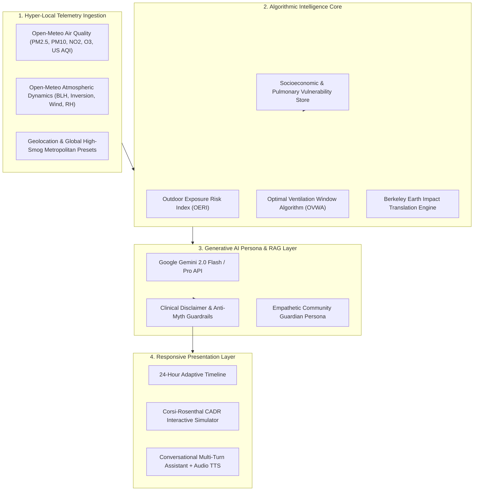

# 🌬️ AuraGuard AI: Urban Air Quality & Winter Smog Assistant
> **PromptWars Virtual 2026 — Challenge 6: Urban Air Quality Assistant**  
> *A Generative AI-powered platform helping families and vulnerable communities mitigate severe winter smog and urban air pollution with hyper-local routines, accessible DIY hacks, and counterfactual impact education.*

[](https://urban-air-assistant.vercel.app)
[](https://ai.google.dev/)
[]()

---

## 📌 Executive Summary & Problem Statement

During severe winter smog episodes in metropolitan regions (such as the Indo-Gangetic Plain, Northern China, Central Valley California, and London corridors), seasonal **thermal inversions** trap particulate matter ($\text{PM}_{2.5}$, $\text{PM}_{10}$), $\text{NO}_2$, and combustion smoke close to ground level. 

Existing air quality applications merely report passive numbers (e.g., *"AQI 425 - Hazardous"*), triggering anxiety without actionable, equitable interventions. Families in informal or drafty housing cannot afford multi-thousand dollar commercial purifiers, nor can daily commuters simply avoid going outdoors.

**AuraGuard AI** addresses this gap by providing an end-to-end, empathetic, and science-grounded assistant that dynamically adapts to **hyper-local microclimate physics**, **socioeconomic reality**, and **individual pulmonary vulnerabilities**.

---

## 🌟 Key Capabilities (Aligned with Challenge 6)

### 1. Personalized 24-Hour Smog Action Plans
- **Diurnal Smog Synchronization**: Automatically synchronizes daily recommendations with atmospheric boundary layer dynamics.
- **Smart Ventilation Window ($OVWA$)**: Pinpoints the optimal 20–45 minute afternoon window when solar thermal heating lifts the boundary layer, allowing fresh air exchange without soot ingress.
- **Microclimate Route & Habit Shifts**: Adapts guidance based on commute mode (walking, two-wheeler, bus, or metro) to shield vulnerable airways during morning rush hours.

### 2. Socioeconomically-Tiered Interventions & DIY Hacks
- **Tier 1 (Zero-Cost Behavioral)**: Damp-cloth doorway infiltration barriers, negative-pressure kitchen isolation, and wet-mopping vs. broom aerosolization mechanics.
- **Tier 2 (Low-Cost DIY)**: Interactive **Corsi-Rosenthal Box** CADR calculator ($15–$25 air cleaner delivering 220+ CFM of clean air) and N95 paper-bag rotation protocols.
- **Tier 3 (Capital Investment)**: HEPA purifier placement optimization and gentle air stratification mixing.

### 3. Science-Based Impact Education & Counterfactual Simulator
- **Biological Mechanism Explanations**: Accessible breakdowns of how sub-micron $\text{PM}_{2.5}$ particles bypass nasal cilia to cause alveolar capillary inflammation.
- **Counterfactual Exposure Calculator**: Real-time simulation of biological outcomes (micrograms of $\text{PM}_{2.5}$ spared from lung deposition, Berkeley Earth secondhand cigarette equivalents avoided, and community tailpipe $\text{CO}_2$ emissions offset).

### 4. Empathetic, Culturally Sensitive GenAI Assistant
- **Empathetic Community Guardian Persona**: Tone-engineered to avoid "doomerism" and smog fatigue, focusing on agency and dignity.
- **Google Gemini 2.0 Integration**: Uses Google Gemini Flash with structured prompt conditioning, supported by an intelligent zero-config local fallback engine for uninterrupted offline evaluation.
- **Multimodal Accessibility**: Integrated Web Speech text-to-speech audio for low-literacy or on-the-go community access.

---

## 📐 System Architecture



---

## 🔬 Mathematical Formulations

### 1. Outdoor Exposure Risk Index ($OERI$)
$$\text{OERI} = \min\left(10, \; \left( \frac{\text{PM}_{2.5}}{15} \cdot 0.75 + \frac{\text{NO}_2}{25} \cdot 0.25 \right) \times V_{\text{vuln}} \times E_{\text{exertion}} \times 0.35\right)$$
- $V_{\text{vuln}}$: Vulnerability multiplier (1.0 for healthy adults, up to 1.9 for asthmatics/infants).
- $E_{\text{exertion}}$: Physical activity multiplier (1.0 for sealed transit, 2.4 for cycling/walking).

### 2. Optimal Ventilation Window Algorithm ($OVWA$)
Ventilation is optimized when solar heating expands the atmospheric boundary layer:
$$\text{Safety Score}(t) = \alpha \cdot \left(1 - \frac{\text{PM}_{2.5}(t)}{\text{Peak}}\right) + \beta \cdot \text{BLH}(t) - \gamma \cdot \text{InversionFlag}(t)$$

---

## 💻 Tech Stack & Zero-Cost Architecture

- **Frontend**: React 18, TypeScript, Vite, Tailwind CSS 3.4, Lucide Icons.
- **GenAI Reasoning**: Google Gemini 2.0 Flash API (via Google AI Studio).
- **Environmental Telemetry**: Open-Meteo Air Quality & Weather API (free, hyper-local, no authentication required).
- **Deployment**: Vercel Edge Network.
- **Repository Size**: < 1 MB (well under the 10 MB competition limit).

---

## 🚀 Getting Started

### Prerequisites
- Node.js 18+ (tested on Node v24)
- npm or pnpm

### Installation
```bash
# Clone the repository
git clone https://github.com/PRIYAGDEV/urban-air-assistant.git

# Navigate to project directory
cd urban-air-assistant

# Install dependencies
npm install

# Start development server
npm run dev
```

### Environment Configuration (Optional)
The application works 100% out of the box using built-in intelligent fallback heuristics. To connect to live Gemini 2.0 Flash:
1. Click the **API Key** button in the header.
2. Enter your free key from [Google AI Studio](https://aistudio.google.com/app/apikey).
3. Alternatively, create `.env` in the root:
   ```env
   VITE_GEMINI_API_KEY="your_api_key_here"
   ```

---

## 👥 Hackathon Submission Details
- **Event**: PromptWars Virtual 2026
- **Challenge**: [Challenge 6] Urban Air Quality Assistant
- **Author**: Priyag Rohilla (`PRIYAGDEV`)

---

## ⚖️ Public Health Disclaimer
*AuraGuard AI provides environmental exposure mitigation strategies based on atmospheric physics and WHO/EPA environmental health guidelines. It does not provide medical diagnoses or alter clinical prescriptions. Consult healthcare professionals for acute respiratory flare-ups.*
