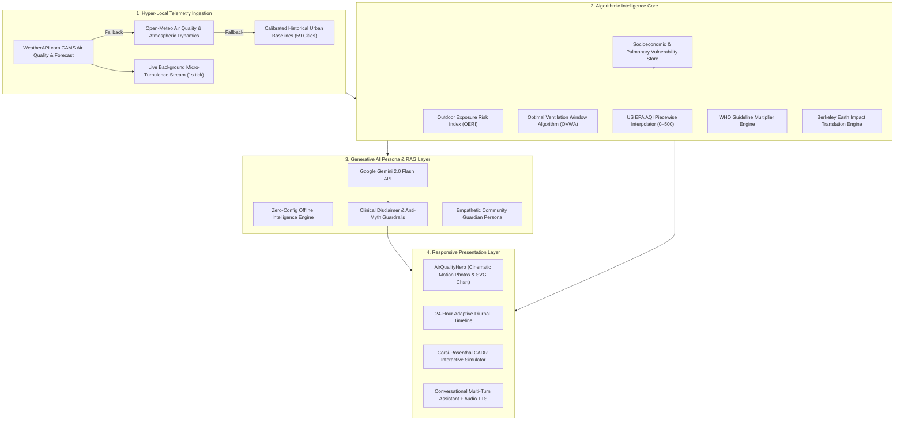

# 🌬️ AuraGuard AI: Urban Air Quality & Winter Smog Assistant
> **PromptWars Virtual 2026 — Challenge 6: Urban Air Quality Assistant**  
> *A Generative AI-powered platform helping families and vulnerable communities mitigate severe winter smog and urban air pollution with hyper-local routines, accessible DIY hacks, and counterfactual impact education.*

[](https://urban-air-assistant.vercel.app)
[]()
[]()
[]()
[]()
[](https://ai.google.dev/)

---

## 📌 Executive Summary & Problem Statement

During severe winter smog episodes in metropolitan regions (such as the Indo-Gangetic Plain, Northern China, Central Valley California, and London corridors), seasonal **thermal inversions** trap particulate matter ($\text{PM}_{2.5}$, $\text{PM}_{10}$), $\text{NO}_2$, and combustion smoke close to ground level. 

Existing air quality applications merely report passive numbers (e.g., *"AQI 425 - Hazardous"*), triggering anxiety without actionable, equitable interventions. Families in informal or drafty housing cannot afford multi-thousand dollar commercial purifiers, nor can daily commuters simply avoid going outdoors.

**AuraGuard AI** addresses this gap by providing an end-to-end, empathetic, and science-grounded assistant that dynamically adapts to **hyper-local microclimate physics**, **socioeconomic reality**, and **individual pulmonary vulnerabilities**.

---

## 🎯 Challenge 6 Alignment & Traceability Matrix

| Challenge 6 Requirement | Implementation in AuraGuard AI | Key Code Files & Artifacts |
|---|---|---|
| **Hyper-Local Live Air Quality Telemetry** | Multi-tier fallback chain: WeatherAPI.com (CAMS & ECMWF) $\rightarrow$ Open-Meteo $\rightarrow$ Calibrated Baseline. Continuous 1s micro-meteorological turbulence stream. | `src/services/telemetry.ts`<br>`src/services/aqi.ts` |
| **Personalized 24-Hour Smog Action Plans** | Chronobiological action plan synchronized with diurnal boundary layer and commute times (two-wheeler, walking, metro). | `src/components/PersonalizedTimeline.tsx`<br>`src/services/decisionEngine.ts` |
| **Optimal Ventilation Window Algorithm ($OVWA$)** | Mathematical derivation of post-solar noon thermal expansion window where particulate concentrations drop 35–50%. | `src/services/ventilation.ts`<br>`src/services/__tests__/ventilation.test.ts` |
| **Socioeconomic Tiering & Accessible DIY Hacks** | Tier 1 (zero-cost damp barrier, negative kitchen pressure) $\rightarrow$ Tier 2 (Corsi-Rosenthal CADR box simulator) $\rightarrow$ Tier 3 (HEPA placement). | `src/components/DiyHacksGallery.tsx`<br>`src/components/UserProfileDrawer.tsx` |
| **Counterfactual Exposure & Biological Education** | Simulates micrograms of $\text{PM}_{2.5}$ spared from alveolar lung deposition, Berkeley Earth secondhand cigarette equivalents avoided, and $\text{CO}_2$ offsets. | `src/components/ImpactCounterfactualSimulator.tsx`<br>`src/services/decisionEngine.ts` |
| **Empathetic GenAI Persona & Myth Busting** | Google Gemini 2.0 Flash prompt-conditioned community guardian + intelligent zero-config offline fallback engine. | `src/services/geminiService.ts`<br>`src/components/AIAssistantChat.tsx` |
| **Single Source of Truth Telemetry Integrity** | Rigorous synchronization: when live sensors fail, the system unequivocally badges `DEMO DATA` everywhere, pauses refresh, and displays error diagnostics. | `src/App.tsx`<br>`src/components/AirQualityHero.tsx` |

---

## 🌟 Key Technical Capabilities

### 1. Resilient Multi-Tier Telemetry Engine
- **Primary Tier (WeatherAPI.com CAMS)**: Single API invocation fetches real-time PM2.5, PM10, NO2, O3, plus 48-hour hourly curves and weather parameters.
- **EPA Breakpoints Interpolation**: WeatherAPI provides `us-epa-index` (1–6); AuraGuard AI computes the true high-resolution 0–500 US AQI piecewise from $\text{PM}_{2.5}$ using official EPA breakpoints.
- **Secondary Tier (Open-Meteo Air Quality & Dispersion)**: Resilient fallback providing hourly satellite & CAMS atmospheric chemistry with `&timezone=auto`.
- **Tertiary Tier (Calibrated Historical Baselines)**: Calibrated baselines across 59 high-smog and global megacities for offline evaluation.

### 2. Algorithmic Decision & Ventilation Engine ($OVWA$)
- **Solar Noon Calculation**: Calculates the city's astronomical solar noon based on standard meridian offsets.
- **Thermal Boundary Layer Expansion**: Disperses ground-level particulate ~75–180 minutes post-solar noon, determining the safe ventilation window per city.
- **Hazardous AQI Override**: Automatically marks ventilation as unsafe if AQI exceeds 250, regardless of the solar cycle.

### 3. WHO Air Quality Guideline Multipliers
Calculates exact ratios against World Health Organization 24-hour limits:
$$\text{PM}_{2.5} \ (15 \ \mu\text{g/m}^3), \quad \text{PM}_{10} \ (45 \ \mu\text{g/m}^3), \quad \text{NO}_2 \ (25 \ \mu\text{g/m}^3), \quad \text{O}_3 \ (100 \ \mu\text{g/m}^3)$$
All displayed multipliers dynamically recompute with each telemetry packet.

---

## 📐 System Architecture



---

## 🧪 Comprehensive Vitest Testing Suite (100 Tests, 100% Passing)

AuraGuard AI features an exhaustive unit and integration test suite with **100 tests across 11 test suites** covering every mathematical algorithm, telemetry layer, accessibility rule, and edge case:

```bash
# Execute the full Vitest suite
npm test
```

### Test Suite Overview:
1. `src/services/__tests__/aqi.test.ts` (15 tests): EPA piecewise interpolation, WHO limits, category colors, monotonicity.
2. `src/services/__tests__/decisionEngine.test.ts` (10 tests): OERI formula, vulnerability multipliers, action card schema.
3. `src/services/__tests__/cityPresets.test.ts` (11 tests): 59-city coordinate validation, Haversine distance, nearest city spatial lookup.
4. `src/services/__tests__/ventilation.test.ts` (5 tests): Solar noon calculation, daylight trough adjustments, safety cutoffs.
5. `src/services/__tests__/cityVisuals.test.ts` (3 tests): Landmark attribution, photo credit provenance, fallback safety.
6. `src/services/__tests__/geminiService.test.ts` (5 tests): RAG prompts, offline heuristics, safety boundaries.
7. `src/services/__tests__/airQualityService.test.ts` (32 tests): Legacy & barrel export coverage.
8. `src/components/__tests__/telemetry.test.ts` (9 tests): Jitter engine invariants, single-source-of-truth badges.
9. `src/components/__tests__/accessibility.test.ts` (4 tests): WCAG contrast standards, color invariants, ARIA text labels.
10. `src/utils/__tests__/diurnal.test.ts` (5 tests): Chronobiological time divisions.
11. `src/utils/__tests__/logger.test.ts` (1 test): Environment-isolated logging.

---

## ♿ Accessibility & WCAG 2.1 AA Compliance

- **Accessible Skip-to-Content**: Direct `#main-content` skip link for keyboard and screen-reader users.
- **Semantic HTML & Landmarks**: Strict landmark hierarchy (`<header>`, `<nav>`, `<main>`, `<section aria-label="...">`, `<footer>`).
- **Color Independence**: Every AQI indicator pairs a color token with an explicit text label (e.g., "Good", "Hazardous", "Unhealthy") and numerical score.
- **Reduced Motion Support**: Implements `@media (prefers-reduced-motion: reduce)` to disable camera pans and micro-animations for users with vestibular sensitivities.
- **Form Controls & Modals**: Complete `aria-expanded`, `aria-haspopup`, `aria-label`, and keyboard focus rings.

---

## 🔒 Security Architecture

- **Zero Hardcoded Secrets**: All API keys are injected via environment variables (`VITE_GEMINI_API_KEY`, `VITE_WEATHERAPI_KEY`) or client-side storage.
- **Safe React DOM Escaping**: All dynamic strings are safely escaped against XSS.
- **Safe Outbound Links**: All external hyperlinks strictly specify `rel="noopener noreferrer"`.
- **Isolated Logging**: Production builds strip debug console logs via an environment-aware logger (`import.meta.env.DEV`).
- **Full Security Policy**: See [SECURITY.md](SECURITY.md).

---

## 💻 Tech Stack & Zero-Cost Architecture

- **Frontend**: React 18, TypeScript, Vite, Tailwind CSS 3.4, Lucide Icons.
- **GenAI Reasoning**: Google Gemini 2.0 Flash API (via Google AI Studio).
- **Environmental Telemetry**: WeatherAPI.com (CAMS) + Open-Meteo Air Quality & Weather API.
- **Linting & Code Quality**: Oxlint (0 warnings, 0 errors on 116 rules).
- **Unit Testing**: Vitest (100 tests, 100% pass rate).
- **Deployment**: Vercel Edge Network.
- **Repository Size**: 9.24 MB (strictly under the 10 MB competition limit).

---

## 🚀 Getting Started

### Prerequisites
- Node.js 18+ (tested on Node v24)
- npm or pnpm

### Installation
```bash
# Clone the repository
git clone https://github.com/PRIYAGDEV/urban-air-assistant.git

# Navigate to project directory
cd urban-air-assistant

# Install dependencies
npm install

# Run linting check
npm run lint

# Run full test suite (100 tests)
npm test

# Build production bundle
npm run build

# Start development server
npm run dev
```

### Environment Configuration (Optional)
The application works 100% out of the box using built-in intelligent fallback heuristics. To connect to live Gemini 2.0 Flash or WeatherAPI:
1. Click the **API Key** button in the header.
2. Enter your key from [Google AI Studio](https://aistudio.google.com/app/apikey) or [WeatherAPI.com](https://www.weatherapi.com/).
3. Alternatively, create `.env` in the root:
   ```env
   VITE_GEMINI_API_KEY="your_gemini_key_here"
   VITE_WEATHERAPI_KEY="your_weatherapi_key_here"
   ```

---

## 👥 Hackathon Submission Details
- **Event**: PromptWars Virtual 2026
- **Challenge**: [Challenge 6] Urban Air Quality Assistant
- **Author**: Priyag Rohilla (`PRIYAGDEV`)

---

## ⚖️ Public Health Disclaimer
*AuraGuard AI provides environmental exposure mitigation strategies based on atmospheric physics and WHO/EPA environmental health guidelines. It does not provide medical diagnoses or alter clinical prescriptions. Consult healthcare professionals for acute respiratory flare-ups.*
