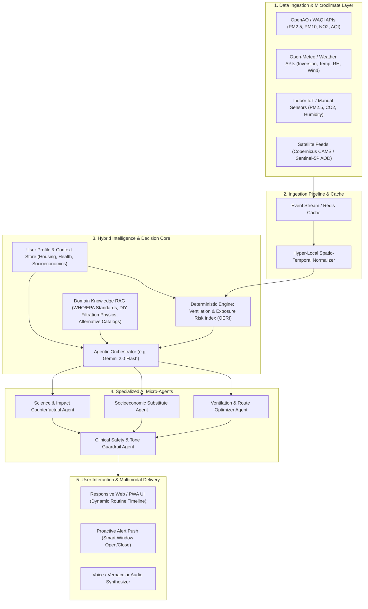
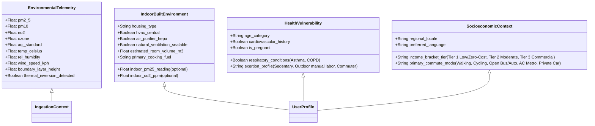
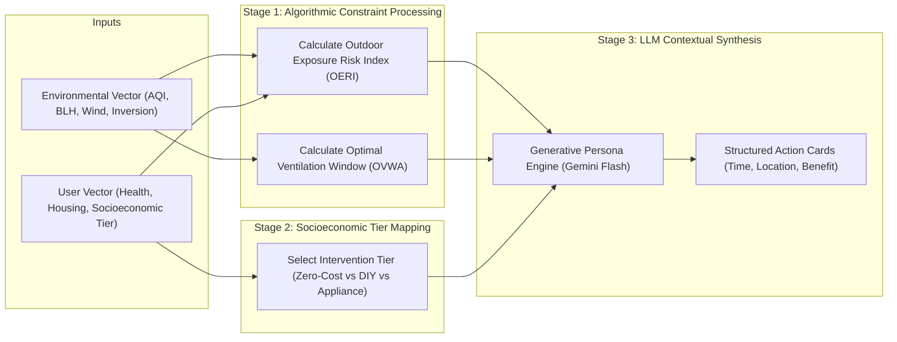
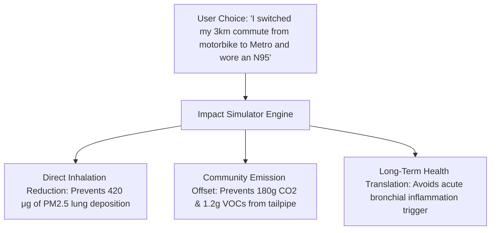

# Urban Air Quality Assistant: Technical & Conceptual Framework

## Goal Description
During severe winter smog episodes in metropolitan regions (driven by seasonal thermal inversions, biomass/stubble burning, vehicular emissions, and industrial stagnation), vulnerable families and communities suffer disproportionate acute and chronic health impacts. Conventional air quality apps merely display passive numbers (e.g., "AQI 420 - Hazardous") without providing contextual, accessible, or socioeconomically viable interventions.

This project designs a **Generative AI-Powered Urban Air Quality Assistant** that transforms real-time hyper-local environmental data, meteorological forecasting, and user-specific constraints into:
1. **Personalized Action Plans**: Dynamic daily schedules, ventilation timing windows, and indoor filtration strategies.
2. **Accessible Sustainable Alternatives**: Socioeconomically tiered substitutions for high-emission habits and consumer items.
3. **Science-Based Impact Education**: Counterfactual impact modeling that transparently explains how individual/community choices directly improve health and local air quality.
4. **Contextual Awareness**: Real-time closed-loop adjustments based on fluctuating pollutants (PM2.5, PM10, NO2, O3, VOCs) and microclimate parameters.

---

## User Review Required

> [!IMPORTANT]
> **Free-Tier & Hackathon Constraints (PromptWars Challenge 6)**: The hackathon guidelines note that no GCP credits are provided, but any AI tool/model can be used. This framework is designed to operate seamlessly on free-tier APIs (e.g., Google Gemini 2.0/1.5 Flash via Google AI Studio API, OpenAQ, Open-Meteo) with zero mandatory infrastructure cost, while remaining architecturally ready for enterprise cloud scale.

> [!WARNING]
> **Clinical & Environmental Safety Guardrails**: Recommendations involving medical conditions (e.g., severe asthma, COPD, pediatric pulmonary risk) must strictly enforce guardrails. The AI assistant provides behavioral, environmental, and physical exposure mitigation strategies, not clinical diagnoses or prescription alterations.

---

## Open Questions

1. **Target Regional Context**: Should the initial reference dataset and persona localization target a specific high-smog urban ecosystem (e.g., Indo-Gangetic Plain / Delhi-NCR, Northern China, Central Valley California, or London/European winter smog corridors), or remain a generalized multi-region configuration?
2. **Deployment Footprint**: For the subsequent prototype phase, do you prefer a lightweight Progressive Web App (PWA) built with **Next.js + Tailwind + Gemini Flash**, or a **FastAPI backend with a chat widget**?

---

## Technical & Conceptual Framework

### 1. System Architecture & Technical Stack

The architecture follows a modern **Event-Driven Agentic RAG (Retrieval-Augmented Generation) & Deterministic Guardrail** design. Real-time data streams and user profiles are continuously harmonized through a hybrid decision engine before reaching the Generative LLM layer.

#### Layer Breakdown

| Layer | Component | Technology / Service | Role & Responsibility |
| :--- | :--- | :--- | :--- |
| **Ingestion** | Environmental Ingestion Workers | OpenAQ API, Open-Meteo, AirNow, PurpleAir | Polls/streams air pollutants and atmospheric boundary layer height every 15–30 mins. |
| **Normalizer** | Geo-Spatial Resolution Engine | Python / Shapely / GeoPandas | Resolves GPS coordinates or neighborhood pincodes to local air quality sensor clusters and terrain-based microclimates. |
| **State & Cache** | In-Memory Cache & State Store | Redis / SQLite / Supabase | Caches real-time AQI and user state to minimize LLM token usage and latency. |
| **RAG Knowledge Base** | Domain Environmental & Health Vector DB | ChromaDB / pgvector / Qdrant | Embeds peer-reviewed studies (WHO, Lancet Planetary Health, EPA), DIY filtration engineering specs (Corsi-Rosenthal box physics), and regional product databases. |
| **LLM Orchestrator** | Multi-Agent Reasoning Core | Google Gemini 2.0 Flash (Function Calling / Structured Outputs) | Ingests real-time parameters, triggers specialized agent prompts, outputs typed JSON action cards. |
| **Guardrails** | Deterministic Safety Filter | NeMo Guardrails / Pydantic Validators | Validates clinical disclaimers, blocks hazardous folk remedies (e.g., burning materials indoors), ensures socioeconomic accessibility checks. |
| **Client / Delivery** | Responsive Frontend & Notification Engine | Next.js 14 / Vite React + Tailwind CSS + WebPush API | Displays timeline cards, daily exposure meters, indoor ventilation countdowns, and conversational chat. |

---

### 2. Data Input Requirements & Comprehensive Taxonomy

To make meaningful, hyper-local recommendations without excessive user friction, data inputs are grouped into four distinct categories:

#### Detailed Taxonomy Specification

1. **Macro & Micro Environmental Streams (External)**:
   - **Pollutant Concentrations**: $\text{PM}_{2.5}$ ($\mu\text{g/m}^3$), $\text{PM}_{10}$, $\text{NO}_2$, $\text{SO}_2$, $\text{CO}$, Ground-Level $\text{O}_3$.
   - **Boundary Layer & Inversion Dynamics**: Mixing layer height (meters), surface vs. upper atmospheric temperature delta ($\Delta T$). *Critical for predicting nocturnal smog trapping.*
   - **Meteorological Dispersion Indices**: Wind vector (direction & velocity), relative humidity (hygroscopic particle growth), precipitation probability, Solar UV radiation.
2. **Indoor Built Environment & Infrastructure**:
   - **Housing Fabric**: Leaky/open brickwork vs. modern sealed double-glazed windows; presence of gaps around doors/balconies.
   - **Filtration Assets**: Mechanical HEPA purifiers, existing ceiling/table fans, kitchen exhaust hoods, or zero active filtration.
   - **Indoor Emission Sources**: Fuel type (LPG vs. piped gas vs. kerosene/wood), incense/dhoop burning, mosquito coil usage, indoor deep-frying.
3. **Health Vulnerability & Lifestyle Profile**:
   - **High-Risk Cohorts**: Children ($<5$ yrs), elderly ($>65$ yrs), pregnant individuals, chronic respiratory/cardiac diagnoses.
   - **Daily Mobility Schedule**: Departure times, outdoor transit durations, school/work commute bottlenecks.
4. **Socioeconomic & Resource Constraints**:
   - **Intervention Tiering**:
     - *Tier 1 (Zero-Cost / Behavioral)*: Wet-mopping techniques, strategic window sealings using damp towels/newspapers, natural air-exchange timing, route detour shifts.
     - *Tier 2 (Low-Cost DIY)*: DIY Corsi-Rosenthal boxes (box fan + MERV13/HEPA filter panels costing $<\$20$), local anti-dust door sweeps, certified N95 masks.
     - *Tier 3 (Capital Investment)*: High-CADR commercial HEPA purifiers, smart indoor air quality monitors, electric induction cookers.

---

### 3. Persona and Tone Guidelines

The assistant operates as an **Empathetic Community Environmental Health Guardian**. In high-pollution seasons, users frequently experience "smog fatigue," anxiety, eco-grief, and helplessness. The tone must never induce fatalism or guilt.

#### Core Persona Attributes

1. **Empathetic & Grounded**: Acknowledges the physical discomfort (stinging eyes, throat irritation) and cognitive burden of living under hazardous smog without scolding or alarmist rhetoric.
2. **Authoritative & Science-Backed**: Backs advice with physical principles (e.g., explaining why $\text{PM}_{2.5}$ bypasses nasal cilia and enters the bloodstream) simplified into crisp metaphors.
3. **Culturally & Socioeconomically Sensitive**: Never suggests tone-deaf solutions (e.g., "Stay home in an air-conditioned room with 4 purifiers" to a daily-wage worker or commuter). Offers dignity-preserving, high-impact alternatives.
4. **Action-Oriented (Anti-Doomerism)**: Focuses on what the user *can* control rather than dwelling exclusively on macro-level air quality indices.

#### Tone Matrix: What to Say vs. What NOT to Say

| Scenario | ❌ Poor / Alarmist / Tone-Deaf Tone | ✅ Recommended Assistant Voice |
| :--- | :--- | :--- |
| **Severe AQI (450+) Outdoors** | "The air outside is toxic and deadly! Lock your doors and do not step outside under any circumstances or you risk severe lung damage." | "Outdoor air is currently in the severe range ($\text{PM}_{2.5}$ 380 $\mu\text{g/m}^3$) due to winter temperature inversion trapping smoke. If you need to head out for your morning commute, wearing a snug-fitting N95 mask will filter out over 95% of these fine particles. Let’s also keep your home’s road-facing windows closed until this afternoon when dispersion improves." |
| **Low-Income Family with No Purifier** | "You should immediately buy two True HEPA air purifiers for your bedroom and living room to protect your children." | "Clean air doesn’t require costly appliances. Let’s set up a 'Clean Air Safe Corner' in your main bedroom. Using a damp cloth to seal the 1-inch gap under your balcony door and damp-mopping floors instead of sweeping prevents settled dust from becoming airborne. If you have an ordinary box fan, we can build a DIY filter for a fraction of the cost." |
| **Cooking & Indoor Habits** | "Stop frying food or lighting incense immediately. You are polluting your own lungs." | "During severe winter inversion, smoke stays trapped indoors much longer. If you’re preparing food today, keeping the kitchen exhaust on or cracking the rear utility window while closing the door to the rest of the house keeps particulate matter from spreading to where your family sleeps." |

---

### 4. Decision Logic & Mapping: Environmental Interventions

The mapping engine reconciles complex environmental variables with user contexts via a 3-stage pipeline:

#### Mathematical Formulation

##### 1. Outdoor Exposure Risk Index ($OERI$)
$$\text{OERI} = \min\left(10, \; \left( \frac{\text{PM}_{2.5}}{C_{\text{base}}} \cdot w_p + \frac{\text{NO}_2}{C_{\text{no2}}} \cdot w_n \right) \times V_{\text{vuln}} \times E_{\text{exertion}}\right)$$
- $C_{\text{base}}$: Baseline reference concentration (e.g., WHO 24-hr guideline: 15 $\mu\text{g/m}^3$).
- $w_p, w_n$: Pollutant severity weights ($w_p = 0.75, w_n = 0.25$).
- $V_{\text{vuln}}$: Vulnerability multiplier:
  - Healthy Adult: $1.0$
  - Elderly / Child: $1.4$
  - Asthmatic / COPD / Cardiac condition: $1.8$
  - Asthmatic Child: $2.1$
- $E_{\text{exertion}}$: Physical activity factor:
  - Resting / Sitting: $1.0$ (Minute ventilation $\sim 6\text{–}8\text{ L/min}$)
  - Brisk Walk / Commute: $2.0$ (Minute ventilation $\sim 20\text{–}25\text{ L/min}$)
  - Running / Heavy Cycling: $4.5$ (Minute ventilation $\sim 60\text{–}80\text{ L/min}$)

##### 2. Optimal Ventilation Window Algorithm ($OVWA$)
Ventilation is a trade-off between indoor $\text{CO}_2$ buildup ($>1000\text{ ppm}$ causes lethargy and headaches) and outdoor $\text{PM}_{2.5}$ ingress:
$$\text{Ventilation Safety Score}(t) = \alpha \cdot \left(1 - \frac{\text{PM}_{2.5}(t)}{\text{Threshold}_{\text{peak}}}\right) + \beta \cdot \text{BLH}(t) + \gamma \cdot \text{WindSpeed}(t) - \delta \cdot \text{Inversion}(t)$$
- $\text{BLH}(t)$: Normalized boundary layer height (typically peaks between 13:00 and 16:00 when solar radiation breaks thermal inversion).
- Inversion flag: 1 if upper air temperature is higher than surface; 0 otherwise.
- **Rule Output**: System pinpoints a 20–30 minute window (typically 13:30–15:00) where outdoor concentrations are at diurnal nadir, instructing the user: *"Ventilate for 20 mins now with cross-breeze, then seal before 17:00 as temperatures drop and evening inversion sets in."*

#### Comprehensive Decision Mapping Matrix

| User Profile Archetype | Environmental State | Algorithmic Decision | Concrete AI Action Recommendation |
| :--- | :--- | :--- | :--- |
| **Single Mother, 2 Children (1 Asthmatic), Informal/Rented Flat, Tier 1 (Zero-Cost)** | AQI: 390 (Hazardous), Thermal Inversion Active, 07:30 AM | **OERI**: 9.4 (Extreme). **Ventilation**: Hermetically sealed. **Strategy**: Micro-zone isolation. | *"Keep roadside windows shut tight this morning. Create a 'Safe Sleeping Zone' in your inner bedroom using rolled damp towels along door cracks. Wet-mop rather than sweep to keep dust down. Postpone children's outdoor playtime until 2:30 PM when the sun disperses surface smoke."* |
| **Outdoor Delivery Worker, 28 yrs, Motorbike Commuter, Tier 2 (Low-Cost DIY)** | AQI: 280 (Very Poor), Dry Cold, 08:30 AM Peak Traffic | **OERI**: 7.8 (High). **Direct Exposure**: Severe vehicular $\text{NO}_2$ & $\text{PM}_{2.5}$. | *"On your motorbike route today, particulate levels at intersections are 2.5x higher than city averages. Wear an N95 mask (reuse cycle: 4 days if stored dry in paper bag). Avoid idling behind heavy diesel trucks at signals; breathe through your nose to leverage natural upper-airway filtering."* |
| **Middle-Income Family, Apartment, Has 1 HEPA Purifier, Tier 2/3** | AQI: 420 (Peak Smog), Low Wind ($<3\text{ km/h}$), 06:00 PM | **OERI**: 8.2. **Filtration**: Continuous. **Indoor Air Hack**: Circulation boost. | *"Place your single HEPA purifier in the bedroom where your family spends 8 continuous sleeping hours, elevated 1 foot off the ground. Run your ceiling fan on the slowest clockwise speed to circulate filtered air without stirring floor dust."* |
| **School Teacher / Jogger, Tier 2, Active Lifestyle** | AQI: 160 (Moderate/Unhealthy for Sensitive), 06:30 AM | **OERI**: 5.2 (elevated due to cardio). | *"Shift your morning outdoor run to an indoor HIIT/stretching session today. Morning winter smog is concentrated in the first 50 meters above ground until 11:00 AM. A 45-minute morning run today would equate to inhaling the particulate equivalent of 4 cigarettes."* |

---

### 5. Science-Based Impact Education & Counterfactual Simulator

A key failure of existing environmental tools is the absence of **actionable agency**: users feel their small choices have no measurable effect. The assistant incorporates a **Counterfactual Environmental & Health Simulator**:

- **Translating Inhalation into Relatable Analogies**:
  - *"By wearing your N95 during today's 45-minute commute, you filtered out approximately $340\,\mu\text{g}$ of fine particulates—the equivalent of avoiding 3.5 secondhand cigarettes."*
- **Community Multiplying Effect**:
  - *"If 50 families in your apartment block delay fireplace/biomass heating by 2 hours until the inversion lifts, neighborhood ground-level smoke density drops by up to 18%."*

---

### 6. Safety, Medical Guardrails & Disclaimers

1. **Non-Diagnostic Constraint**: System messages append a deterministic disclaimer whenever respiratory symptoms are mentioned: *"I provide environmental exposure mitigation guidance. If you or your child experience chest tightness, wheezing unresponsive to regular inhalers, or persistent breathlessness, consult your healthcare provider or emergency services immediately."*
2. **Combating Toxic Myths**:
   - The system vector store contains pre-vetted debunks for common dangerous folk remedies:
     - ❌ *"Burning camphor / essential oils purifies indoor smog"* $\rightarrow$ **Correction**: Generates harmful volatile organic compounds (VOCs) and ultrafine particles.
     - ❌ *"Boiling water with eucalyptus cleans the room"* $\rightarrow$ **Correction**: Elevates indoor humidity above 70%, accelerating dust-mite proliferation and particulate retention.
     - ❌ *"Ordinary surgical / cloth masks protect against winter smog"* $\rightarrow$ **Correction**: Fine $\text{PM}_{2.5}$ particles slip through gaps; only tight-seal N95/FFP2 masks are effective.

---

## Verification Plan

### Automated Tests
1. **API Integration & Data Parsing**:
   - Verify `OpenAQ` and `Open-Meteo` responses parse cleanly into typed Pydantic models.
   - Test fallback behavior when hyper-local station data is missing (interpolating nearest neighbor stations).
2. **Algorithmic Validation**:
   - Unit test the $OERI$ calculation across all vulnerability and exertion tiers.
   - Unit test the $OVWA$ ventilation window timing to confirm it never recommends ventilation during peak night/morning inversion periods.
3. **Guardrail & Prompt Red-Teaming**:
   - Test LLM responses with adversarial inputs (e.g., asking if burning wood indoors is safe, requesting medical prescriptions for asthma). Verify 100% adherence to safety guidelines.

### Manual Verification
1. **Socioeconomic Appropriateness**:
   - Run sample queries for Tier 1 (low income) vs. Tier 3 (high income) profiles to verify no tone-deaf commercial product recommendations leak into Tier 1 advice.
2. **Dynamic Responsiveness**:
   - Change simulated AQI from 80 (Moderate) to 480 (Hazardous) and verify that the generated daily routine dynamically adapts (cancels outdoor jogging, triggers sealed ventilation alerts).
